# Controle de Acesso por Reconhecimento Facial

## Integrantes do Grupo
- Diego Mourão Oliveira
- Ilan Hameiry
- Luca Lopes Martinho

## Descrição do Projeto

## Funcionamento do Sistema

## Objetivos do Projeto

## Requisitos do Sistema

### Requisitos Obrigatórios

| ID | Requisito | Tipo |
|:---:|:---|:---:|
| RO-01 | Microprocessador Raspberry Pi 4 | Obrigatório |
| RO-02 | Câmera de vídeo digital | Obrigatório |
| RO-03 | Comunicação de microprocessador com dashboard online | Obrigatório |
| RO-04 | Interação com usuário | Obrigatório |

### Requisitos Desejáveis

| ID | Requisito | Tipo |
|:---:|:---|:---:|
| RD-01 | Sensor de distância | Desejável |
| RD-02 | Interface gráfica | Desejável |

### Requisitos Opcionais

| ID | Requisito | Tipo |
|:---:|:---|:---:|
| ROP-01 | Mensagens sonoras  | Opcional |
| ROP-02 | Leitor por aproximação  | Opcional |

### Componentes Utilizados

- 1 Raspberry Pi 4 8 Gb Ram
- 1 Carão MicroSD 16 Gb
- 1 Módulo Conversor de Nível Lógico 3,3V - 5V
- 1 Webcam HD Full USB 2.0 A0198
- 2 LEDs 5mm (1 vermelha e 1 verde)
- 2 Resistores 33 Ω
- 1 Sensor Ultrassônico HC-SR04
- 1 Protoboard 170 pontos

## Diagrama de Blocos
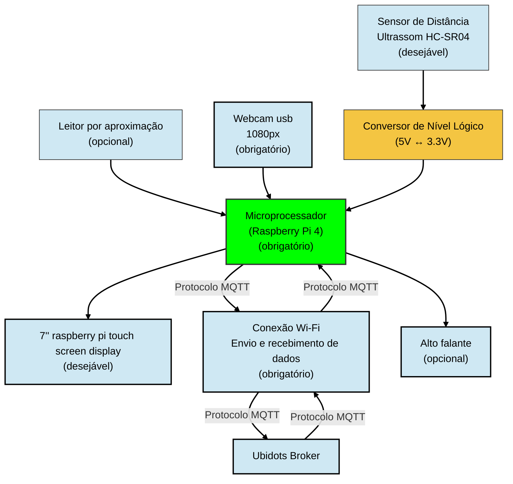

## Softwares Utilizados

Durante o desenvolvimento do projeto foram utilizados os seguintes softwares:

- [Thonny](https://thonny.org/) — utilizado para programação, testes e depuração do Raspberry Pi 4
- [RealVNC Viewer](https://www.realvnc.com/en/connect/download/viewer/?lai_sr=0-4&lai_sl=l) - utilizado para conectar e programar o raspberry pi remotamente, assim não necessitando um monitor, teclado e mouse apenas para interagir com o microporcessador
  
## Tecnologias Envolvidas

## Modelo CAD

### Imagens assembly

| Vista Frontal | Vista Lateral |
| :---: | :---: |
| 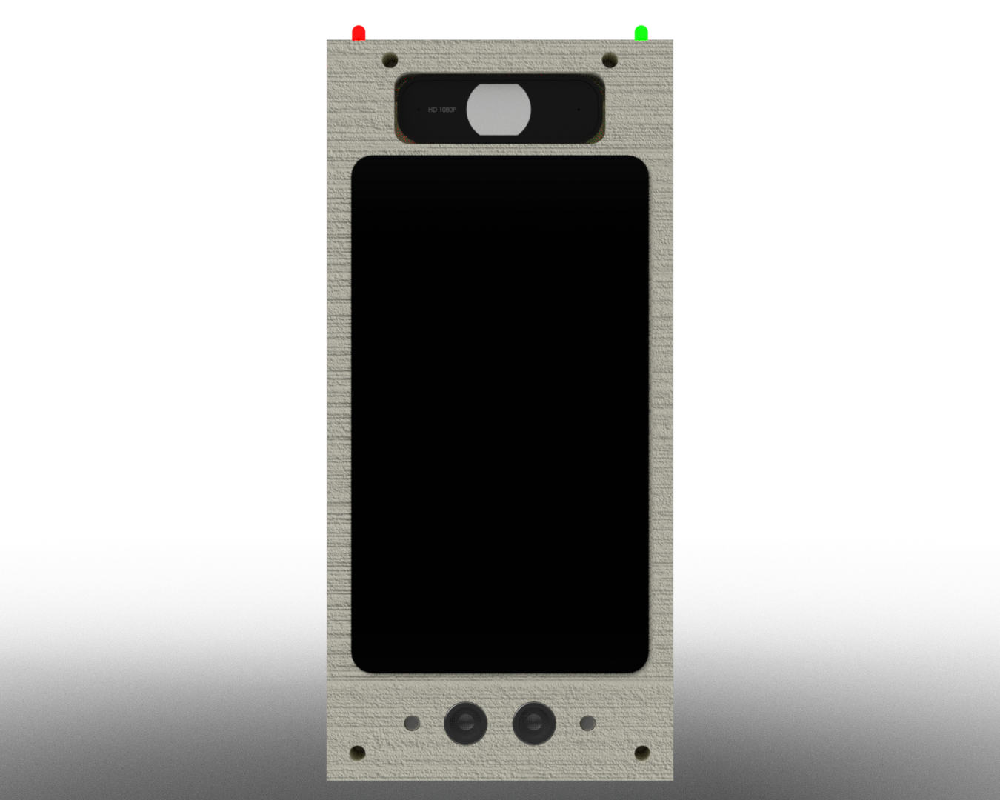 | 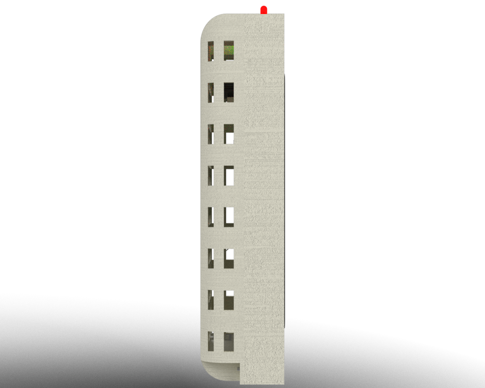 |

| Vista Traseira | Vista Isométrica |
| :---: | :---: |
| 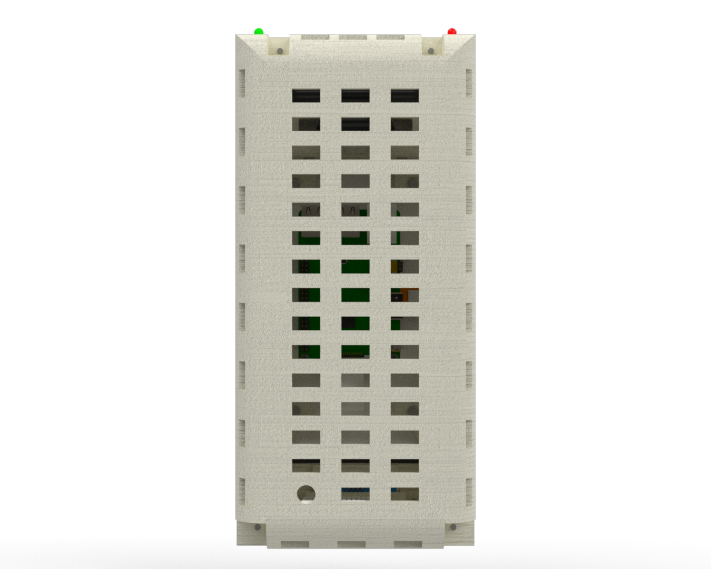 | 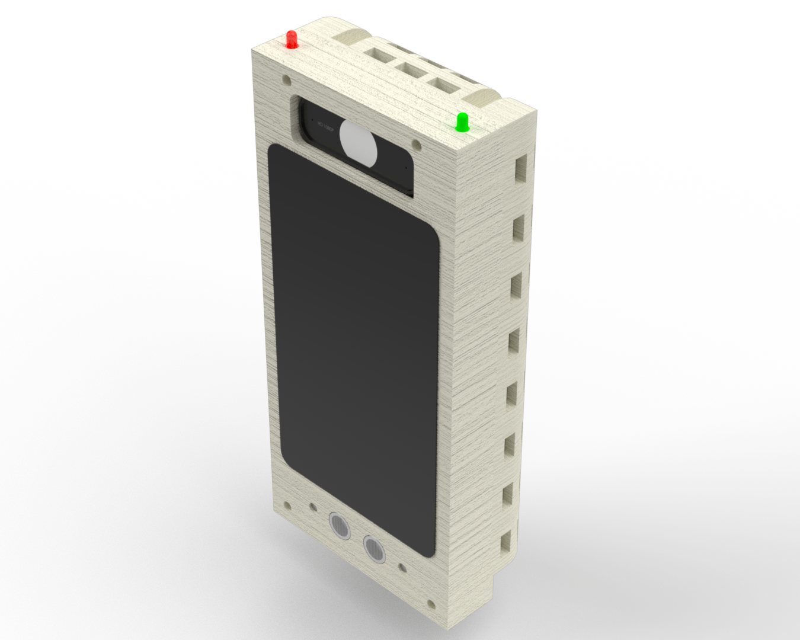 |

| Encaixes Internos | 
| :---: |
| 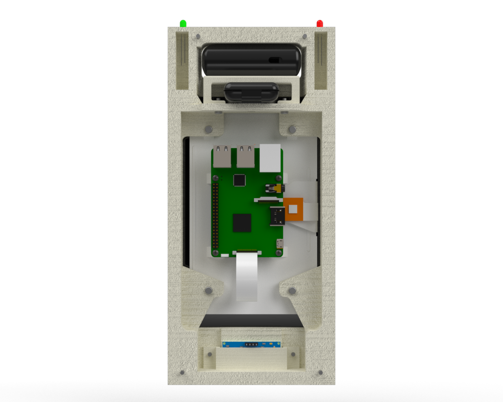 |

### Arquivos baixados pela internet

| Display | Webcam | LED | Ultrassom | Protoboard |
| :---: | :---: | :---: | :---: | :---: |
| [Modelo CAD Display + Raspberry Pi](https://grabcad.com/library/raspberry-pi-display-7-1) | [Modelo CAD Webcam](https://grabcad.com/library/rapoo-c260-usb-black-full-hd-webcam-1) | [Modelo CAD LED 5mm](https://grabcad.com/library/led-5mm-1) | [Modelo CAD Sensor Ultrassom HC-SR04](https://grabcad.com/library/ultrasonic-sensor-hc-sr04-3) | [Modelo CAD Protoboard 170 pinos](https://grabcad.com/library/little-protoboard-sldprt-1) | 
| Feito por: [max morozov](https://grabcad.com/max.morozov-2) | Feito por: [Ayman Abasi](https://grabcad.com/ayman.abasi-1) | Feito por: [Lucas Ribeiro](https://grabcad.com/lucas.ribeiro) | Feito por: [MRMS - WORKSHOP](https://grabcad.com/mrms.workshop-1) | Feito por: [Marcos Dalmeida](https://grabcad.com/marcos.dalmeida-1) |

## Imagens do Projeto

### Montagem

| Vista Frontal | Vista Lateral | Vista Traseira |
| :---: | :---: | :---: |
| 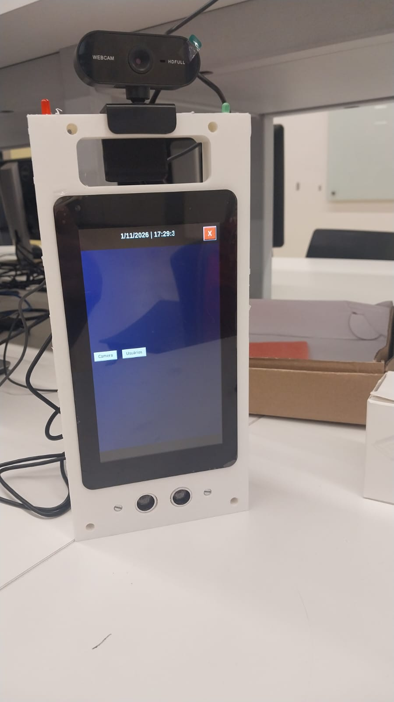 | 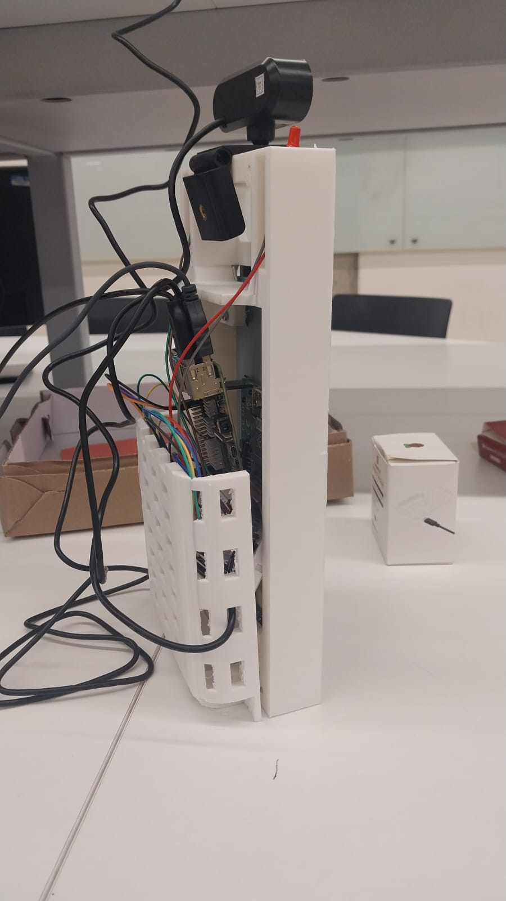 | 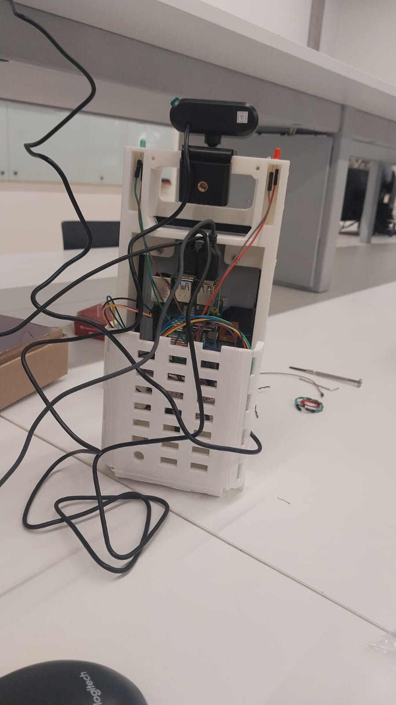 |

### Circuito

| Integrado a montagem (perto) | Integrado a montagem (longe) | Circuito isolado  |
| :---: | :---: | :---: |
| 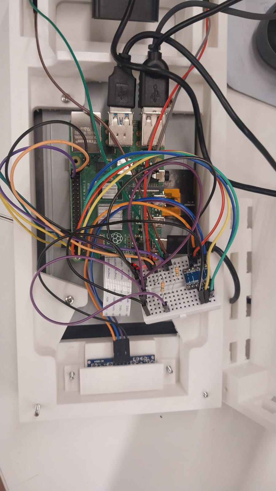 | 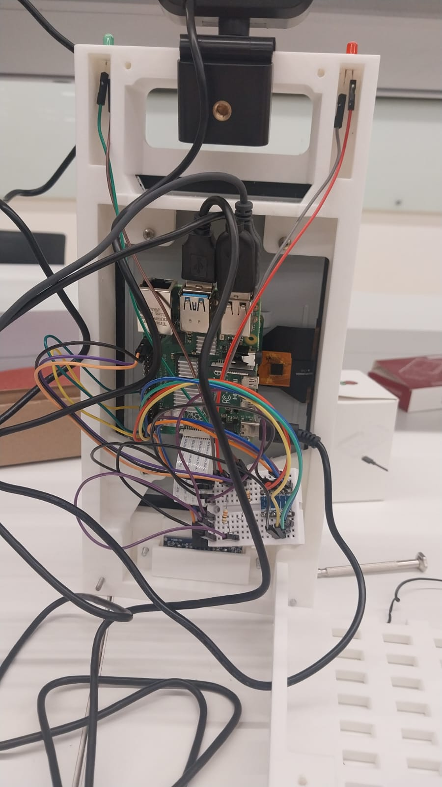 | 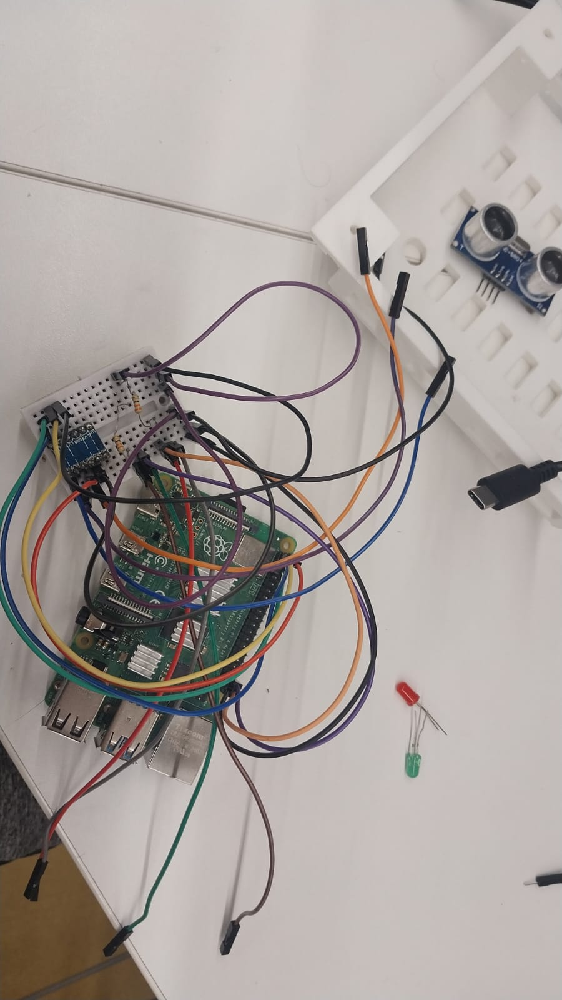 |

## Apresentação do Projeto em Vídeo
