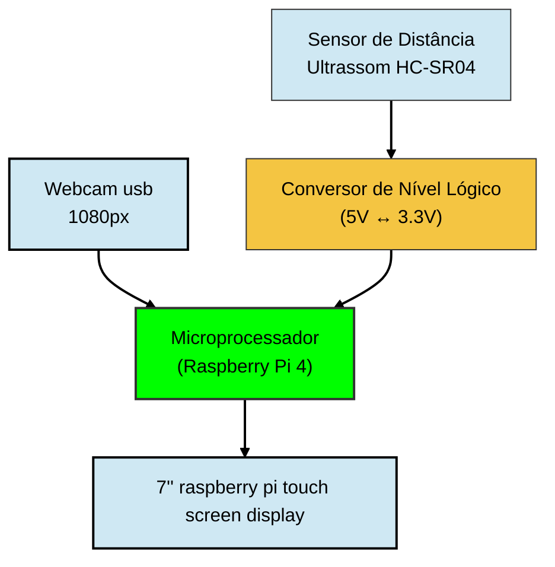

# Controle de Acesso por Reconhecimento Facial

## Integrantes do Grupo
- Diego Mourão Oliveira
- Ilan Hameiry
- Luca Lopes Martinho

## Descrição do Projeto

## Funcionamento do Sistema

## Objetivos do Projeto

## Requisitos do Sistema

### Requisitos Obrigatórios

| ID | Requisito | Tipo |
|:---:|:---|:---:|

### Requisitos Desejáveis

| ID | Requisito | Tipo |
|:---:|:---|:---:|

### Requisitos Opcionais

| ID | Requisito | Tipo |
|:---:|:---|:---:|

### Componentes Utilizados

- 1 Raspberry Pi 4 8 Gb Ram
- 1 Carão MicroSD 16 Gb
- 1 Módulo Conversor de Nível Lógico 3,3V - 5V
- 1 Webcam HD Full USB 2.0 A0198
- 2 LEDs 5mm (1 vermelha e 1 verde)
- 2 Resistores 33 Ω
- 1 Sensor Ultrassônico HC-SR04
- 1 Protoboard 170 pontos

## Diagrama de Blocos

## Softwares Utilizados

Durante o desenvolvimento do projeto foram utilizados os seguintes softwares:

- [Thonny](https://thonny.org/) — utilizado para programação, testes e depuração do Raspberry Pi 4
- [RealVNC Viewer](https://www.realvnc.com/en/connect/download/viewer/?lai_sr=0-4&lai_sl=l) - utilizado para conectar e programar o raspberry pi remotamente, assim não necessitando um monitor, teclado e mouse apenas para interagir com o microporcessador
  
## Tecnologias Envolvidas

## Imagens do Modelo

| Vista Frontal | Vista Lateral |
| :---: | :---: |
|  |  |
|
| Vista Traseira | Vista Isométrica |
| :---: | :---: |
|  |  |
|
| Encaixes Internos | 
| :---: |
|  |

## Imagens do Projeto

### Montagem

| Vista Frontal | Vista Lateral | Vista Traseira |
| :---: | :---: | :---: |
|  |  |  |

### Circuito

| Integrado a montagem (perto) | Integrado a montagem (longe) | Circuito isolado  |
| :---: | :---: | :---: |
|  |  |  |

## Apresentação do Projeto em Vídeo
